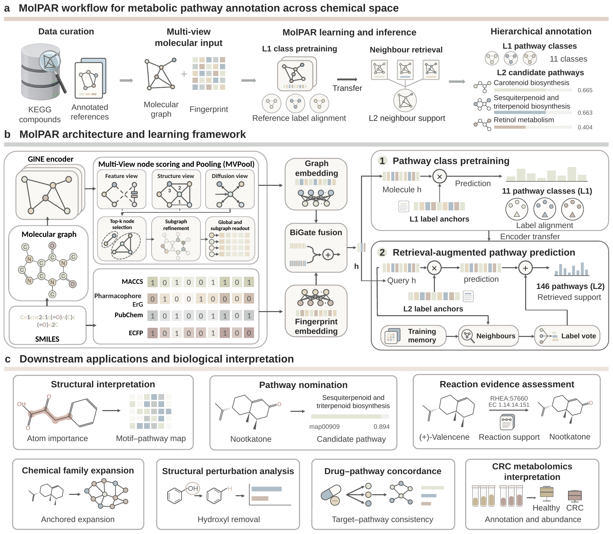
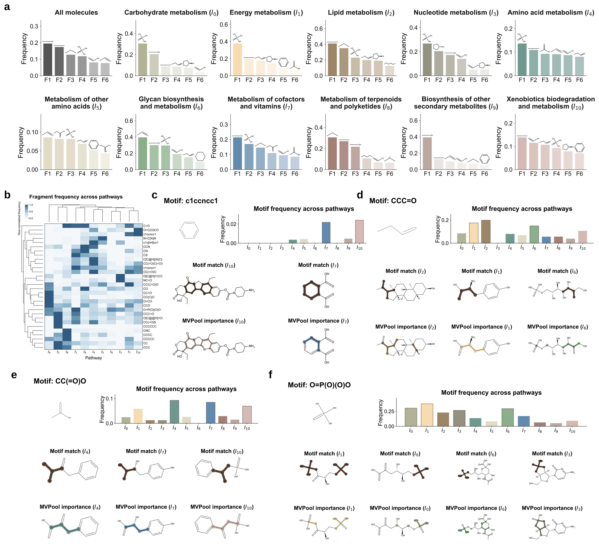
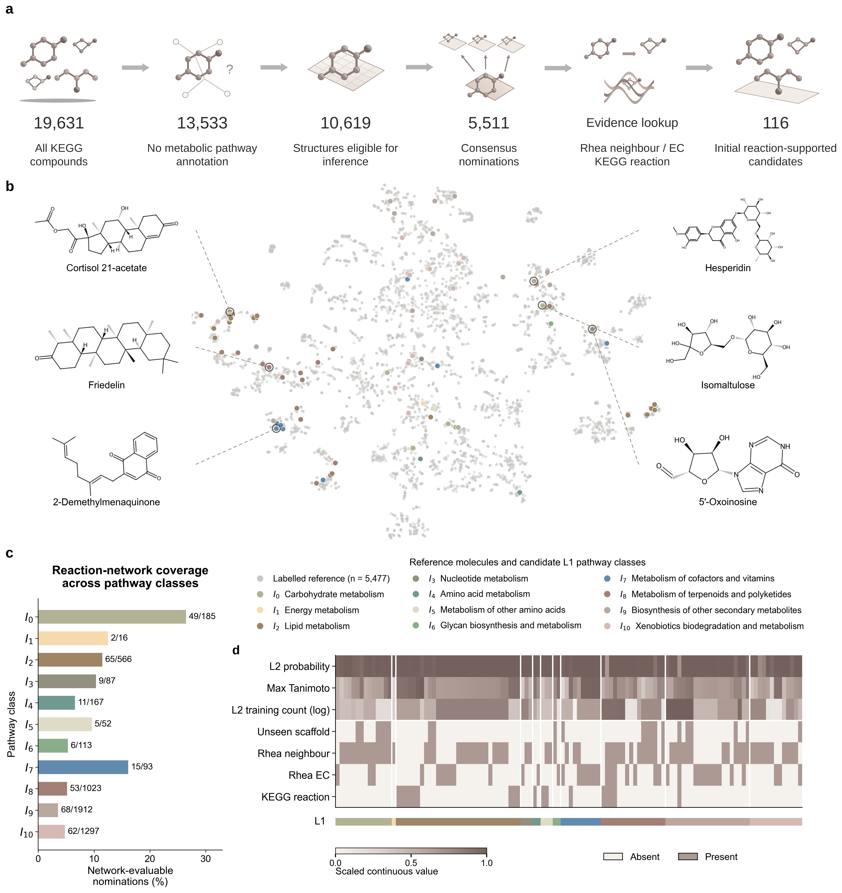
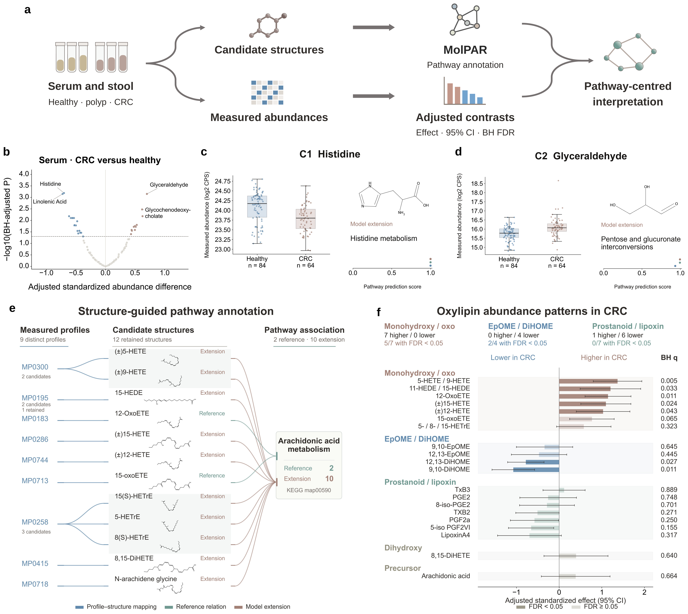

# MolPAR: Metabolic Pathway Annotation across Chemical Space

Accurate metabolic pathway annotation of small molecules is essential for connecting chemical structures to biological function. However, many compounds remain insufficiently annotated, limiting pathway-level interpretation in biochemical research and metabolomics.

MolPAR is a retrieval-augmented, multi-view learning framework for multi-label metabolic pathway prediction. It integrates a molecular graph encoder and a molecular fingerprint branch through a BiGate fusion module. Within the graph branch, MVPool combines feature, structure, and diffusion information to identify informative subgraphs and refine molecular representations. Training proceeds from 11 broad metabolic classes (L1) to 146 specific pathways (L2), combining classification objectives with label-anchor alignment. At the L2 stage, predictions are further informed by neighboring compounds retrieved from a training-only reference memory.

The framework supports pathway nomination for unannotated compounds and downstream biochemical and metabolomic interpretation. The accompanying datasets cover candidate prioritization, reaction evidence, chemical families, drug–pathway relationships, and metabolomics analyses.



## Installation

Clone or download this repository, then run the following commands from its root directory. Python 3.11 is used for the tested environment.

```bash
conda create -n molpar python=3.11
conda activate molpar
python -m pip install -r requirements.txt
```

CPU inference is supported. For GPU execution, use a compatible PyTorch/CUDA installation.

## Repository Contents

```text
data/
  raw/                 Source data grouped into four ZIP archives
  final/
    training/          Molecular dataset and pathway definitions
    interpretability/  Final fragment-frequency table
    candidates/        Candidate predictions and final nominations
    reactions/         Reaction evidence, chemical families, and structural edits
    drugs/             Drug annotations and pathway-related reference data
    metabolomics/      Abundance tables, sample metadata, and structure mappings
code/
  model/               Model architecture, features, losses, and training scripts
  preprocessing/       Source retrieval and data-processing scripts
  downstream/          Downstream analysis methods
  run_downstream.py    Run downstream analyses
  prepare_training.py  Generate inputs for model training
  evaluate_seed0.py    Evaluate the released checkpoint
  predict.py           Predict pathways for new molecules
weights/
  molpar_seed0.pth      Released random_seed0 Stage-2 checkpoint
results/
  figures/             Manuscript result figures
  summary.csv          Main numerical findings
requirements.txt
README.md
workflow.png
```

The training dataset contains **5,477 molecular structures**, annotated with **11 L1 classes** and **146 L2 pathways**. `data/final/training/molecules.csv` contains the molecular structures, labels, and original split membership and order in the `split_seed0` and `split_order_seed0` columns. The training, validation, and test partitions contain **4,381 / 547 / 549** molecules, respectively. `data/final/training/pathways.csv` defines the pathway labels and their hierarchy. Label indices are zero-based.

The repository includes source data, final datasets, and preprocessing code. The raw archives contain study-specific source records. Metabolomics datasets include processed abundance tables, sample metadata, and molecular structure mappings.

## Model Training

Training consists of L1 pretraining followed by L2 fine-tuning with retrieval augmentation. Use `--no_label_gcn` in both stages to match the MolPAR configuration.

### 1. Prepare the training inputs

Generate the CSV, label definitions, and split file expected by the original training scripts:

```bash
python code/prepare_training.py --output-dir outputs/training_inputs
```

The script reconstructs the split from the final dataset. `random_seed0` identifies the data partition; the training random seed is `42`.

Semantic initialization additionally requires Transformers and access to the BioBERT model specified below:

```bash
python -m pip install transformers
```

### 2. Pretrain on L1 classes

```bash
python code/model/train_stage1.py \
  --csv_path outputs/training_inputs/kegg2026_hier.csv \
  --index_path outputs/training_inputs/random_seed0.txt \
  --label_json_path outputs/training_inputs/label_space_L1.json \
  --num_l1 11 \
  --batch_size 128 \
  --epochs 200 \
  --lr 1e-3 \
  --seed 42 \
  --lambda_anchor 0.3 \
  --temperature 0.1 \
  --no_label_gcn \
  --semantic_init \
  --biobert_model dmis-lab/biobert-base-cased-v1.2 \
  --ckpt_dir outputs/stage1
```

The checkpoint with the best validation sample-wise F1 is saved to `outputs/stage1/stage1_best.pth`.

### 3. Fine-tune on L2 pathways

```bash
python code/model/train_stage2.py \
  --csv_path outputs/training_inputs/kegg2026_hier.csv \
  --index_path outputs/training_inputs/random_seed0.txt \
  --label_l1_json outputs/training_inputs/label_space_L1.json \
  --label_l2_json outputs/training_inputs/label_space_L2.json \
  --stage1_ckpt outputs/stage1/stage1_best.pth \
  --num_l1 11 \
  --num_l2 146 \
  --batch_size 128 \
  --epochs 100 \
  --lr 1e-3 \
  --encoder_lr_ratio 0.1 \
  --seed 42 \
  --lambda_anchor 0.3 \
  --temperature 0.1 \
  --no_label_gcn \
  --semantic_init \
  --biobert_model dmis-lab/biobert-base-cased-v1.2 \
  --use_retrieval \
  --retrieval_k 32 \
  --retrieval_beta 0.3 \
  --ckpt_dir outputs/stage2
```

The checkpoint with the best validation macro-F1 is saved to `outputs/stage2/stage2_best.pth`. Both training scripts automatically use CUDA when available. For offline training, set `--biobert_model` to a local BioBERT directory.

## Model Evaluation

Evaluate the released `weights/molpar_seed0.pth` checkpoint on the original validation and test partitions:

```bash
python code/evaluate_seed0.py \
  --output-dir outputs/evaluation \
  --device cpu
```

The script saves `metrics.json`, `validation_predictions.npz`, and `test_predictions.npz`. Reported metrics include sample-wise precision, recall, F1, and Jaccard accuracy, together with macro-F1 and macro-AUPRC. Binary predictions use a threshold of `0.5`.

The local CPU check reproduced test sample-wise F1 of **0.75739006** and macro-F1 of **0.58914872**. Evaluation follows the original benchmark batch protocol.

## Prediction on New Molecules

Create an `input.csv` file containing a `smiles` column. An optional `molecule_id` column may be provided; identifiers must be unique and nonempty.

```csv
molecule_id,smiles
histidine,N[C@@H](Cc1cnc[nH]1)C(=O)O
glyceraldehyde,O=CC(O)CO
```

Run prediction with the released checkpoint:

```bash
python code/predict.py \
  --input input.csv \
  --output-dir outputs/prediction \
  --device cpu \
  --top-k 10
```

The output directory contains:

| File | Contents |
| --- | --- |
| `top_pathways.csv` | Top-ranked L2 pathways for each molecule |
| `all_pathway_scores.csv` | Scores for all 146 L2 pathways |
| `probabilities.npz` | Score matrix and molecule identifiers |
| `prediction_manifest.json` | Input, model, and inference settings |

By default, the script returns pathway rankings. Add `--threshold 0.5` if binary predictions are needed, or use `--device cuda:0` for GPU inference. Use a new output directory for each prediction, evaluation, or training-input preparation run.

The first prediction run builds a retrieval memory from the 4,381 training molecules; subsequent runs can reuse the generated cache. Keep the training dataset and its split columns in place. Inputs must be valid, connected molecular structures. To control the batch dependence of the original pooling implementation, each query is evaluated with a fixed background of 255 training molecules. This prediction protocol differs from the benchmark batching used by the evaluation script.

## Downstream Analyses

The analysis code in [`code/downstream/`](code/downstream/) connects pathway predictions to molecular interpretation, biochemical reactions, chemical families, drug targets, and metabolomics measurements. Run the analyses from the repository root:

```bash
python code/run_downstream.py --analysis all --output-dir outputs/downstream
```

This command computes candidate nominations, reaction-support statistics, reaction-network paths, chemical families, structural-edit comparisons, drug–pathway concordance, and CRC metabolomics results. Outputs are written into one subdirectory per analysis. Each analysis can also be run separately:

```bash
python code/run_downstream.py --analysis reactions --output-dir outputs/reactions
python code/run_downstream.py --analysis families --output-dir outputs/families
python code/run_downstream.py --analysis drugs --output-dir outputs/drugs
python code/run_downstream.py --analysis metabolomics --output-dir outputs/metabolomics
```

The downstream analyses use the study prediction and evidence tables in `data/final/`. Chemical-space projection and checkpoint-based atom scoring have separate commands:

```bash
python code/run_downstream.py --analysis chemical-space --output-dir outputs/chemical_space
python code/run_downstream.py --analysis mvpool --input input.csv --output-dir outputs/atom_scores --device cpu
```

For atom scoring, `input.csv` uses the same SMILES format as the prediction example. The output records each atom's MVPool score and whether it reaches the molecule-wise 70th percentile. Omitting `--input` scores the complete molecular reference. Atom scoring follows the single-molecule interpretation protocol; pathway prediction uses the prediction command above.

| Analysis | Implementation | Procedure and principal outputs |
| --- | --- | --- |
| Encoder interpretation | [`run_downstream.py`](code/run_downstream.py) | The `mvpool` command extracts atom scores and highlights atoms at or above the molecule-wise 70th percentile. Outputs `atom_scores.csv`. |
| Candidate nomination and chemical space | [`run_downstream.py`](code/run_downstream.py), [`chemical_space.py`](code/downstream/chemical_space.py) | Apply cross-model agreement, L1–L2 compatibility, score thresholds, and pathway-unassigned status. Outputs `final_nominations.csv`. Joint ECFP4 projection uses 50-component SVD followed by t-SNE. |
| Reaction evidence and pathway specificity | [`reactions.py`](code/downstream/reactions.py), [`network.py`](code/downstream/network.py) | Traverse opposite reaction sides for up to three steps, excluding high-degree currency participants. Compare nominated pathways with size-matched alternatives and perform within-L1 permutations. Outputs network support, matched-control tests, and BH-adjusted enzyme-class enrichment. |
| Chemical-family expansion | [`families.py`](code/downstream/families.py) | Use the frozen nomination flags for Butina clustering of ECFP4 fingerprints at Tanimoto similarity 0.55; group candidates sharing a predicted pathway with a directly supported anchor. Outputs family membership, pathway agreement, and reaction-context summaries. |
| Local structural edits | [`structural_edits.py`](code/downstream/structural_edits.py) | Generate chemically sanitized edits and compare the recorded original and edited scores across models. Includes maximum-common-substructure and functional-group comparison functions. Outputs `generated_edits.csv`, `edit_score_changes.csv`, and `edit_summary.csv`. |
| Drug–pathway concordance | [`drugs.py`](code/downstream/drugs.py) | Compare predicted pathway ranks with references derived from direct human drug targets, after excluding exact reference-structure overlaps. Outputs per-drug ranks, Top-1/3/5 recovery, scaffold-stratified results, and bootstrap intervals. |
| CRC metabolomics | [`metabolomics.py`](code/downstream/metabolomics.py) | Recompute log-abundance effects adjusted for age and sex using HC3 standard errors and BH correction; join structure-level annotations to distinct measurement profiles. Outputs serum and stool effects, annotation extensions, and oxylipin summaries. |

Reaction permutation analyses use 1,000 permutations by default; set `--permutations` to increase this number. Network matched-control tests use the stored size-matched pathway sets and 10,000 Monte Carlo draws. Stool abundance testing collapses identical measurement profiles and applies correction across 753 profiles; serum correction covers 113 features. Source retrieval and initial evidence-review scripts are in [`code/preprocessing/`](code/preprocessing/).

## Results


| Application | Main result |
| --- | --- |
| Pathway nomination | 5,511 nominations from 10,619 eligible structures |
| Reaction-network support | 67 of 345 network-evaluable nominations have direct L2 support; 134 have support within three reactions |
| Pathway specificity | In the separate 366-compound reaction-context population, 67 direct matches versus a within-L1 permutation mean of 17.7; 3.78-fold enrichment |
| Chemical-family expansion | 30 families with 167 additional compounds: 51 with reaction context and 116 prospective members |
| Drug–pathway concordance | Target-associated pathways recovered at rank one for 17/114 drugs, within the top three for 24/114, and within the top five for 28/114 |
| CRC metabolomics | 84 serum and 342 stool structure–pathway associations added beyond exact reference mapping; 29/113 serum features have BH-adjusted *q* < 0.05 |

### Molecular fragments and encoder interpretation

BRICS profiles identify recurring motifs across metabolic classes. The molecular examples relate motif locations to the regions retained by MVPool, including pyridine, carbonyl, carboxyl, and phosphate motifs.

<details>
<summary>View molecular interpretation results</summary>



</details>

### Pathway nomination and biochemical evidence

Consensus prediction extends pathway annotation beyond the curated reference. Reaction review connects nominated compounds to annotated participants, while the strict network analysis measures support across seen, unseen, and acyclic scaffolds. Within-class label permutations test specificity at the individual-pathway level. Structural edits examine the response of pathway scores to local chemical changes.

<details>
<summary>View candidate nomination and chemical-space results</summary>



</details>


### Evidence-anchored chemical families

Directly supported compounds anchor related molecular series with shared pathway predictions. Of the 167 expansion compounds, 121 have maximum reference ECFP4 similarity below 0.8 and 62 have unseen nonempty scaffolds. Examples include epothilones, flavonoids, and terpenoid quinones.


### Drug–pathway concordance

Drug structures are evaluated against pathway references derived from independently recorded human targets. Top-five matches include 18 of 78 drugs with unseen scaffolds, seven of 25 with seen scaffolds, and three of 11 acyclic drugs. Cedazuridine illustrates agreement between a predicted pathway and its target-associated reference.


### CRC metabolomics interpretation

Structure-based annotation is integrated with measured abundance changes in serum (ST000284) and stool (ST002787). Histidine is lower and glyceraldehyde higher in CRC serum. In stool, the illustrated arachidonic-acid subset links nine measured profiles to 12 retained structures. The exploratory oxylipin analysis resolves contrasting abundance patterns among monohydroxy/oxo, EpOME/DiHOME, and prostanoid/lipoxin products.

<details open>
<summary>View CRC metabolomics results</summary>



</details>
